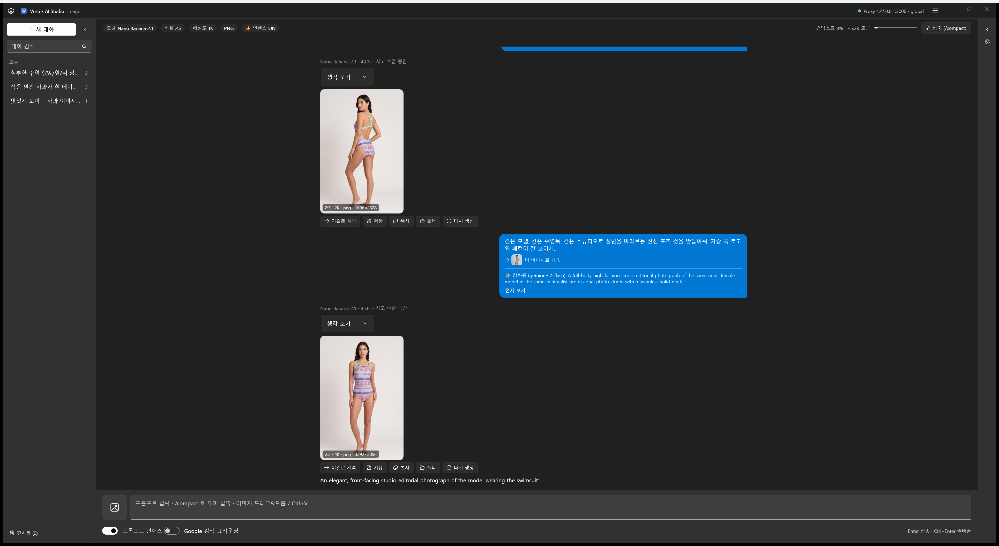
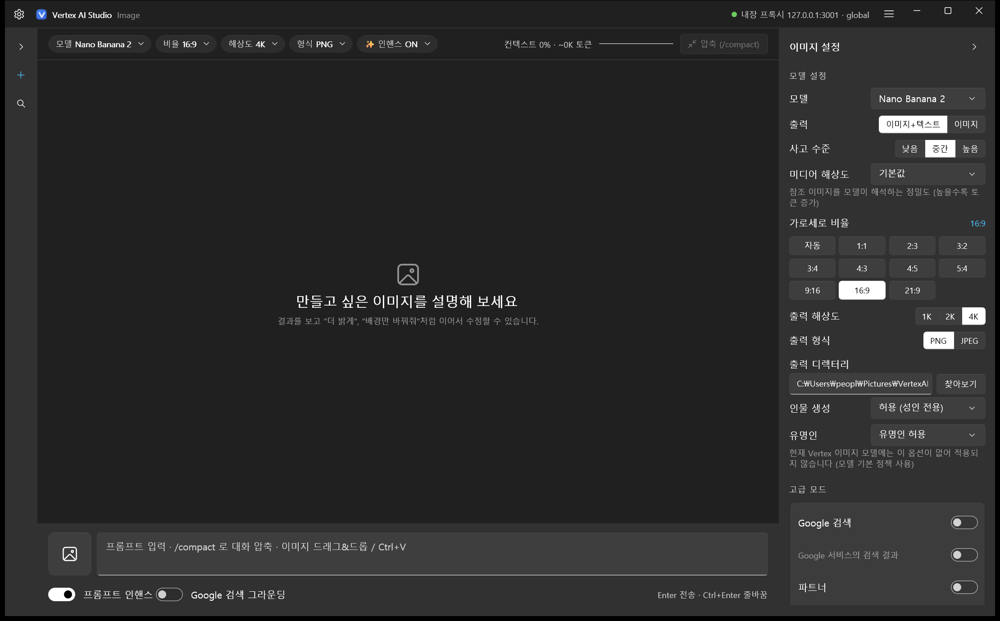

# Vertex AI Studio (Image)

[한국어](README.md) | **English**

A Windows app for **creating and iteratively editing images in a chat** with Google Vertex AI image models
(the Nano Banana family). [Vertex OpenAI Proxy](https://github.com/designloves2/vertex-openai-proxy) is built in,
so **signing in with your Google account** is all it takes — no separate server to run.

## Install

1. Download `VertexAIStudioApp-win-Setup.exe` from the [latest release](https://github.com/designloves2/Vertex-AI-Studio/releases/latest) and run it.
   - The installer is not code-signed; if SmartScreen warns, choose **More info → Run anyway**.
   - .NET, the Windows App SDK and the Node.js runtime are bundled — nothing else to install (Windows 10 1809+ / 11).
2. **Vertex AI Studio** appears on the desktop and in the Start menu.
3. On first launch the **Get started with your Google account** page opens. Sign in in the browser window; everything else is automatic.

| Step | What happens |
|---|---|
| 1. Google Cloud CLI | Installed per user if missing (no admin rights) |
| 2. Google sign-in | Browser sign-in → Application Default Credentials |
| 3. Project | Picked automatically if you have one, otherwise chosen from a list |
| 4. Vertex AI permission | `roles/aiplatform.user` checked and granted if missing |
| 5. Vertex AI API | `aiplatform.googleapis.com` enabled |
| 6. Embedded proxy | Started on `127.0.0.1:3001` |

- You need a Google Cloud project with billing. The setup page tells you when billing or a project is missing.
- On a PC that already has Vertex OpenAI Proxy, its `.env` (project, region, model) is imported on first launch.
- To run the setup again: ⚙ Settings › **Embedded proxy · Google account** › **Google account setup**.

## Features

**Chat-style generation and editing**
- Conversations and images are saved, so you can keep editing after restarting the app or the next day.
- Edit the previous result ("make it brighter", "change only the background"); **Continue with this** pins the base image.
- Reference images: drag & drop, Ctrl+V or the attach button.
- Per-image save / copy / open folder / regenerate. Preview opens fit-to-window with wheel zoom, drag to pan, double-click to fit.

**Context management**
- The conversation is re-sent with every request, with only the latest N images (default 3) inlined.
- `/compact` (or the **Compact** button) summarises the conversation and keeps the 2 latest images; it also runs automatically at a threshold (default 80%).

**Prompt enhance**
- An LLM (default `gemini-3.7-flash`, configurable) rewrites your prompt into a detailed image prompt; both versions are shown.

**Vertex image options**
- Models: Nano Banana 2.1 / 2 / 2 lite / Pro … listed as `friendly name (model id)`
- Output (image + text / image only), thinking level (low/medium/high), media resolution
- 10 aspect ratios (auto = 2:3, 1:1, 2:3, 3:2, 3:4, 4:3, 4:5, 5:4, 9:16, 16:9, 21:9), output resolution 1K/2K/4K, PNG/JPEG
- Person generation (all ages / adults / none), region, max output tokens, streaming
- Options a model rejects are dropped and retried, and listed above the result as "options not applied".

**UI**
- Both the conversation list (left) and the image settings panel (right) fold away; their state is remembered.
- Top-bar dropdowns change model, ratio, resolution, format and enhance directly — kept in sync with the panel in real time.
- Send key: Enter or Ctrl+Enter (the other one inserts a newline).

## Updates and uninstall

- On start the app checks GitHub Releases and shows a banner when a newer version exists; **Update and restart** downloads it and relaunches.
  Turn auto-check off or check now under ⚙ Settings › Updates.
- Uninstall from Windows Settings › Apps. Conversations, images and settings (`%LOCALAPPDATA%\VertexAIStudio`) are kept.

## Where data lives

| Location | Contents |
|---|---|
| `%LOCALAPPDATA%\VertexAIStudio\studio.db` | Conversations and messages (SQLite) |
| `%LOCALAPPDATA%\VertexAIStudio\images\` | Original images as received (never re-encoded) |
| `%LOCALAPPDATA%\VertexAIStudio\settings.json` | App settings |
| `Pictures\VertexAIStudio\` (configurable) | Results saved in the chosen output format |
| `%APPDATA%\gcloud\application_default_credentials.json` | Google sign-in (gcloud ADC) |
| `%LOCALAPPDATA%\VertexAIStudioApp\` | Installed app (removed on uninstall) |

## Development

- .NET 8 SDK, WinUI 3 (Windows App SDK 1.6), unpackaged + self-contained, Velopack (install/update)
- `src/ImageStudio.Core` — UI-free logic: proxy client, SQLite store, history builder, `/compact`, embedded proxy host, Google setup
- `src/ImageStudio.App` — the WinUI 3 app
- `tests/ImageStudio.Tests` — xUnit (`dotnet test tests/ImageStudio.Tests`)
- `proxy/` — embedded proxy (a copy of vertex-openai-proxy's `index.js`; `UPSTREAM_COMMIT` records the source commit)
  - Run `npm ci` in `proxy` once before a dev run (node is taken from PATH)
  - Refresh: `.\proxy\sync-from-upstream.ps1 [-Upstream <path to the proxy repo>]`

## Release

1. Bump `<Version>` in `src/ImageStudio.App/ImageStudio.App.csproj`.
2. `.\release.ps1 -Publish` — tests → publish → bundle the embedded proxy (+ node.exe) → Velopack installer and delta packages → GitHub release `v<version>`
   - Requires Node.js, `dotnet tool install -g vpk --version 1.2.161`, `gh auth login`
   - Without `-Publish` it only builds the installer into `artifacts\releases`.

The install folder (`%LOCALAPPDATA%\VertexAIStudioApp`) is deleted on uninstall, so it must differ from the data folder.

## License

The embedded proxy (`proxy/`) is under its upstream MIT license (`proxy/LICENSE`).
