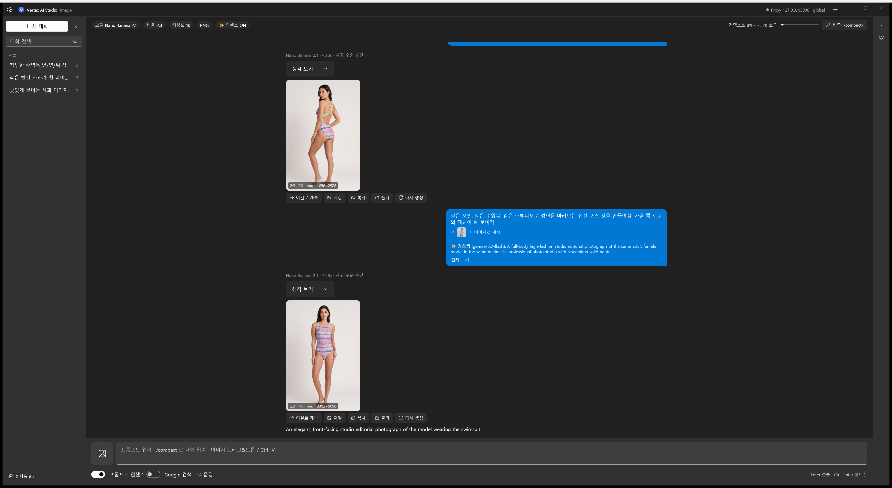
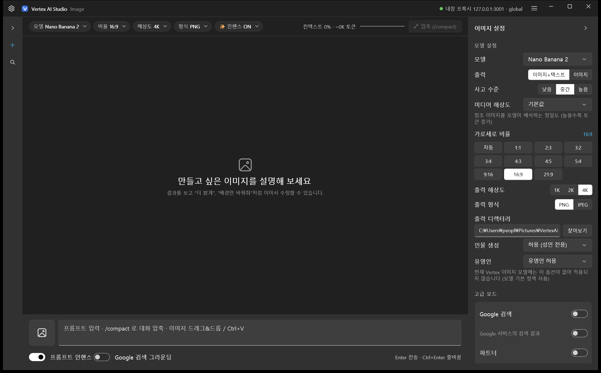

# Vertex AI Studio (Image)

Google Vertex AI 이미지 모델(Nano Banana 계열)로 **대화하듯 이미지를 만들고 이어서 수정**하는 Windows 앱입니다. [Vertex OpenAI Proxy](https://github.com/designloves2/vertex-openai-proxy)가 내장되어 있어, 별도 프로그램 없이 **Google 계정 로그인만으로** 바로 사용할 수 있습니다.
A Windows app for **creating and iteratively editing images in a chat** with Google Vertex AI image models (the Nano Banana family). [Vertex OpenAI Proxy](https://github.com/designloves2/vertex-openai-proxy) is built in, so **signing in with your Google account** is all it takes — no separate server to run.

## 설치 / Install

1. [최신 릴리즈](https://github.com/designloves2/Vertex-AI-Studio/releases/latest)에서 `VertexAIStudioApp-win-Setup.exe`를 받아 실행합니다.
   Download `VertexAIStudioApp-win-Setup.exe` from the [latest release](https://github.com/designloves2/Vertex-AI-Studio/releases/latest) and run it.
   - 코드 서명이 없는 설치 파일이라 SmartScreen 경고가 나오면 **추가 정보 → 실행**을 누릅니다.
     The installer is not code-signed; if SmartScreen warns, choose **More info → Run anyway**.
   - .NET, Windows App SDK, Node.js 런타임이 함께 들어 있어 따로 설치할 것이 없습니다 (Windows 10 1809 이상 / 11).
     .NET, the Windows App SDK and the Node.js runtime are bundled — nothing else to install (Windows 10 1809+ / 11).
2. 설치가 끝나면 바탕화면과 시작 메뉴에 **Vertex AI Studio**가 생깁니다.
   **Vertex AI Studio** appears on the desktop and in the Start menu.
3. 처음 실행하면 **Google 계정으로 시작하기** 화면이 열립니다. 브라우저 창에서 로그인만 하면 나머지는 자동입니다.
   On first launch the **Get started with your Google account** page opens. Sign in in the browser window; everything else is automatic.

| 단계 / Step | 내용 / What happens |
|---|---|
| 1. Google Cloud CLI | 없으면 사용자 계정에 자동 설치 (관리자 권한 불필요) · Installed per user if missing (no admin rights) |
| 2. Google 로그인 / sign-in | 브라우저 로그인 → Application Default Credentials 생성 · Browser sign-in → ADC |
| 3. 프로젝트 / Project | 하나면 자동, 여러 개면 목록에서 선택 · Picked automatically if only one, otherwise from a list |
| 4. Vertex AI 권한 / permission | `roles/aiplatform.user` 확인, 없으면 부여 · Checked and granted if missing |
| 5. Vertex AI API | `aiplatform.googleapis.com` 사용 설정 · Enabled |
| 6. 내장 프록시 / Embedded proxy | `127.0.0.1:3001`에서 실행 · Started on `127.0.0.1:3001` |

- 결제 계정이 연결된 Google Cloud 프로젝트가 필요합니다. 결제나 프로젝트가 없으면 설정 화면이 안내합니다.
  You need a Google Cloud project with billing; the setup page tells you when billing or a project is missing.
- 기존 Vertex OpenAI Proxy가 설치된 PC라면 그 `.env`의 프로젝트·리전·모델 설정을 처음 실행할 때 자동으로 가져옵니다.
  On a PC that already has Vertex OpenAI Proxy, its `.env` (project, region, model) is imported on first launch.
- 설정을 다시 하려면 ⚙ 설정 › **내장 프록시 · Google 계정** › **Google 계정 설정**을 누릅니다.
  To run the setup again: ⚙ Settings › **Embedded proxy · Google account** › **Google account setup**.

## 주요 기능 / Features

**대화형 생성·수정 / Chat-style generation and editing**
- 대화 기록과 생성 이미지가 저장되어 앱을 다시 켜도, 다음 날에도 이어서 수정합니다.
  Conversations and images are saved, so you can keep editing after a restart or the next day.
- "더 밝게", "배경만 바꿔줘"처럼 이전 결과를 기준으로 수정하고, **이걸로 계속**으로 기준 이미지를 지정합니다.
  Edit the previous result ("make it brighter", "change only the background"); **Continue with this** pins the base image.
- 참조 이미지 첨부: 드래그&드롭, Ctrl+V, 첨부 버튼.
  Reference images: drag & drop, Ctrl+V or the attach button.
- 이미지별 저장 / 복사 / 폴더 열기 / 다시 생성. 미리보기는 화면 맞춤, 휠 줌, 드래그 이동, 더블클릭 맞춤.
  Per-image save / copy / open folder / regenerate. Preview opens fit-to-window with wheel zoom, drag to pan, double-click to fit.

**컨텍스트 관리 / Context management**
- 요청마다 대화 기록을 다시 보내되, 최근 이미지 N장(기본 3)만 실제 이미지로 포함합니다.
  The conversation is re-sent with every request, with only the latest N images (default 3) inlined.
- `/compact` 명령이나 **압축** 버튼으로 대화를 요약해 컨텍스트를 줄입니다(기준 이미지 2장 유지). 임계치(기본 80%)에서 자동 압축.
  `/compact` (or the **Compact** button) summarises the conversation and keeps the 2 latest images; it also runs automatically at a threshold (default 80%).

**프롬프트 인핸스 / Prompt enhance**
- 입력한 프롬프트를 LLM(기본 `gemini-3.7-flash`, 변경 가능)이 상세한 이미지 프롬프트로 다듬어 보냅니다. 원문과 강화문을 함께 표시합니다.
  An LLM (default `gemini-3.7-flash`, configurable) rewrites your prompt into a detailed image prompt; both versions are shown.

**Vertex 이미지 옵션 / Vertex image options**
- 모델: Nano Banana 2.1 / 2 / 2 lite / Pro 등 — `별칭 (모델 ID)`로 표시
  Models: Nano Banana 2.1 / 2 / 2 lite / Pro … listed as `friendly name (model id)`
- 출력(이미지+텍스트 / 이미지), 사고 수준(낮음/중간/높음), 미디어 해상도
  Output (image + text / image only), thinking level (low/medium/high), media resolution
- 가로세로 비율 10종(자동=2:3, 1:1, 2:3, 3:2, 3:4, 4:3, 4:5, 5:4, 9:16, 16:9, 21:9), 출력 해상도 1K/2K/4K, PNG/JPEG
  10 aspect ratios (auto = 2:3, 1:1, 2:3, 3:2, 3:4, 4:3, 4:5, 5:4, 9:16, 16:9, 21:9), output resolution 1K/2K/4K, PNG/JPEG
- 인물 생성(모든 연령 / 성인 / 허용 안 함), 리전, 출력 토큰 한도, 스트리밍
  Person generation (all ages / adults / none), region, max output tokens, streaming
- 모델이 받아들이지 않는 옵션은 빼고 다시 요청하며, 결과 위에 "적용되지 않은 옵션"으로 알려 줍니다.
  Options a model rejects are dropped and retried, and listed above the result as "options not applied".

**화면 / UI**
- 왼쪽 대화 목록과 오른쪽 이미지 설정 패널을 각각 접을 수 있습니다(상태 기억).
  The conversation list (left) and the image settings panel (right) each fold away; their state is remembered.
- 상단 드롭다운에서 모델·비율·해상도·형식·인핸스를 바로 변경 — 접힌 패널과 실시간으로 동기화됩니다.
  Top-bar dropdowns change model, ratio, resolution, format and enhance directly — kept in sync with the panel in real time.
- 전송 키: Enter 또는 Ctrl+Enter 중 선택(나머지는 줄바꿈).
  Send key: Enter or Ctrl+Enter (the other one inserts a newline).

## 업데이트와 제거 / Updates and uninstall

- 앱이 시작할 때 GitHub Releases를 확인해 새 버전이 있으면 상단에 알려 줍니다. **업데이트 후 재시작**을 누르면 받아서 다시 시작합니다. ⚙ 설정 › 업데이트에서 자동 확인을 끄거나 바로 확인할 수 있습니다.
  On start the app checks GitHub Releases and shows a banner when a newer version exists; **Update and restart** downloads it and relaunches. Turn auto-check off or check now under ⚙ Settings › Updates.
- 제거는 Windows 설정 › 앱에서 합니다. 대화·이미지·설정(`%LOCALAPPDATA%\VertexAIStudio`)은 제거해도 남습니다.
  Uninstall from Windows Settings › Apps. Conversations, images and settings (`%LOCALAPPDATA%\VertexAIStudio`) are kept.

## 데이터 위치 / Where data lives

| 위치 / Location | 내용 / Contents |
|---|---|
| `%LOCALAPPDATA%\VertexAIStudio\studio.db` | 대화·메시지 (SQLite) · Conversations and messages |
| `%LOCALAPPDATA%\VertexAIStudio\images\` | 받은 원본 이미지 (재인코딩 없음) · Original images as received |
| `%LOCALAPPDATA%\VertexAIStudio\settings.json` | 앱 설정 · App settings |
| `사진\VertexAIStudio\` / `Pictures\VertexAIStudio\` | 출력 형식으로 저장한 결과 (변경 가능) · Results in the chosen format (configurable) |
| `%APPDATA%\gcloud\application_default_credentials.json` | Google 로그인 정보 · Google sign-in (gcloud ADC) |
| `%LOCALAPPDATA%\VertexAIStudioApp\` | 설치된 앱 (제거 시 삭제) · Installed app (removed on uninstall) |

## 개발 / Development

- .NET 8 SDK, WinUI 3 (Windows App SDK 1.6), unpackaged + self-contained, Velopack (설치·업데이트 / install & update)
- `src/ImageStudio.Core` — UI 없는 로직: 프록시 클라이언트, SQLite 저장소, 기록 구성, `/compact`, 내장 프록시 실행, Google 설정
  UI-free logic: proxy client, SQLite store, history builder, `/compact`, embedded proxy host, Google setup
- `src/ImageStudio.App` — WinUI 3 앱 / the WinUI 3 app
- `tests/ImageStudio.Tests` — xUnit (`dotnet test tests/ImageStudio.Tests`)
- `proxy/` — 내장 프록시 (vertex-openai-proxy의 `index.js` 사본, `UPSTREAM_COMMIT`에 기준 커밋)
  Embedded proxy (a copy of vertex-openai-proxy's `index.js`; `UPSTREAM_COMMIT` records the source commit)
  - 개발 실행 전 `proxy` 폴더에서 `npm ci` 한 번 (node는 PATH에서 찾음)
    Run `npm ci` in `proxy` once before a dev run (node is taken from PATH)
  - 갱신 / Refresh: `.\proxy\sync-from-upstream.ps1 [-Upstream <proxy repo path>]`

## 릴리즈 / Release

1. `src/ImageStudio.App/ImageStudio.App.csproj`의 `<Version>`을 올립니다.
   Bump `<Version>` in `src/ImageStudio.App/ImageStudio.App.csproj`.
2. `.\release.ps1 -Publish` — 테스트 → 게시 → 내장 프록시(+node.exe) 포함 → Velopack 설치 파일·델타 패키지 → GitHub 릴리즈 `v<버전>`
   tests → publish → bundle the embedded proxy (+ node.exe) → Velopack installer and delta packages → GitHub release `v<version>`
   - 필요 / Requires: Node.js, `dotnet tool install -g vpk --version 1.2.161`, `gh auth login`
   - `-Publish` 없이 실행하면 `artifacts\releases`에 설치 파일만 만듭니다.
     Without `-Publish` it only builds the installer into `artifacts\releases`.

설치 폴더(`%LOCALAPPDATA%\VertexAIStudioApp`)는 제거할 때 지워지므로 데이터 폴더와 이름이 달라야 합니다.
The install folder (`%LOCALAPPDATA%\VertexAIStudioApp`) is deleted on uninstall, so it must differ from the data folder.

## 라이선스 / License

내장 프록시(`proxy/`)는 원본 저장소의 MIT 라이선스(`proxy/LICENSE`)를 따릅니다.
The embedded proxy (`proxy/`) is under its upstream MIT license (`proxy/LICENSE`).
